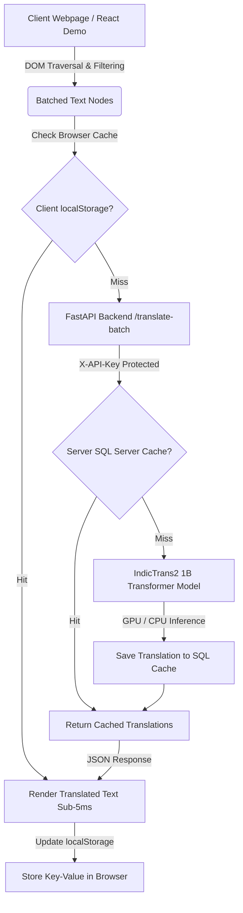

# Multilingual Website Translator

[](https://www.python.org/)
[](https://fastapi.tiangolo.com/)
[](https://pytorch.org/)
[](https://huggingface.co/ai4bharat/indictrans2-en-indic-1B)
[](https://react.dev/)
[](https://vitejs.dev/)
[](LICENSE)

An enterprise-grade, full-stack AI translation platform designed to dynamically translate entire web applications into **11+ major Indian languages** in real time. Powered by AI4Bharat's **IndicTrans2** transformer model, a high-throughput **FastAPI** backend, a resilient **two-tier caching architecture** (browser `localStorage` + SQL Server SHA-256 hash lookup), and an **embeddable, framework-agnostic JavaScript widget** that can be injected into any external website with a single `<script>` tag.

---

## 🌟 Key Highlights

- **State-of-the-Art Neural Machine Translation:** Integrated with `ai4bharat/indictrans2-en-indic-1B` Seq2Seq transformer for accurate English-to-Indic translation, utilizing CUDA GPU acceleration when available with automatic CPU fallback.
- **Intelligent DOM Traversal & Text Batching:** Traverses the live document tree, filters out non-translatable tokens (code, numbers, formulas, scripts, SVG icons), and batches text nodes to minimize network roundtrips.
- **High-Throughput Batch Translation API:** Asynchronous FastAPI endpoints (`/translate-batch`) capable of handling complex web pages with dozens of text segments in unified parallel requests.
- **Resilient 2-Tier Caching System:**
  - **Tier 1 (Client-Side):** Instantaneous sub-5ms translations powered by browser `localStorage` to eliminate redundant server requests on visited pages.
  - **Tier 2 (Server-Side):** Persistent SQL Server caching keyed by `SHA-256(SourceText) + TargetLang` with indexed lookups (`IX_TranslationCache_Lookup`).
  - **Fail-Soft Architecture:** Automatically falls back to raw inference if database connectivity is unavailable without interrupting user experience.
- **Universal Embeddable Widget (`translator_widget.js`):** Lightweight vanilla JavaScript widget that can be embedded into any web framework (React, Next.js, Vue, Angular, WordPress, or plain HTML) via a drop-in `<script>` tag.
- **Corporate Demo Portal:** Fully responsive, accessible React 18 single-page application built with Vite and Tailwind/Vanilla CSS, featuring dark/light modes and seamless live translation.

---

## 🌐 Supported Languages

| Language | Script / Code | Native Name |
| :--- | :--- | :--- |
| **English** | `eng_Latn` | English |
| **Hindi** | `hin_Deva` | हिन्दी |
| **Odia** | `ory_Orya` | ଓଡ଼ିଆ |
| **Bengali** | `ben_Beng` | বাংলা |
| **Marathi** | `mar_Deva` | मराठी |
| **Telugu** | `tel_Telu` | తెలుగు |
| **Tamil** | `tam_Taml` | தமிழ் |
| **Gujarati** | `guj_Gujr` | ગુજરાતી |
| **Kannada** | `kan_Knda` | ಕನ್ನಡ |
| **Malayalam** | `mal_Mlym` | മലയാളം |
| **Urdu** | `urd_Arab` | اردو |

---

## 🏗️ Architecture Overview



---

## 📁 Repository Structure

```text
Multilingual-Website-Translator/
│
├── backend/
│   ├── app/
│   │   ├── main.py              # FastAPI application & REST endpoints
│   │   ├── translator.py        # IndicTrans2 model loader & inference engine
│   │   ├── batch_translation.py # Batching queue & translation orchestrator
│   │   ├── cache.py             # SQL Server two-tier caching logic
│   │   ├── database.py          # pyodbc database connector & connection pooling
│   │   ├── models.py            # Pydantic request/response schemas
│   │   └── static/
│   │       └── translator_widget.js # Embeddable JavaScript widget script
│   └── requirements.txt         # Python dependencies
│
├── frontend/
│   ├── public/
│   │   └── translator_widget.js # Static distribution widget
│   ├── src/
│   │   ├── components/          # Reusable UI components (Header, Footer, LanguageSelector)
│   │   ├── context/             # TranslationContext & global language state
│   │   ├── pages/               # Demo pages (Home, About, Services, Management, Contact)
│   │   ├── services/            # API client layer
│   │   └── translation/         # DOM parsing, text splitting & batch logic
│   ├── package.json             # Frontend dependencies & build scripts
│   └── vite.config.js           # Vite development & build configuration
│
├── .env.example                 # Environment configuration template
├── .gitignore                   # Git exclusion rules
├── Multilingual_Website_Translation_Platform_Documentation.pdf # Full Platform Spec & Architecture Guide
└── README.md                    # Project documentation
```

---

## 🚀 Getting Started

### Prerequisites

- **Python:** 3.10 or newer
- **Node.js:** 18.0 or newer & `npm`
- **PyTorch:** Supports CPU execution out of the box; NVIDIA GPU with CUDA recommended for real-time inference speed.
- **SQL Server (Optional):** ODBC Driver 18 for SQL Server (caching is automatically bypassed if not configured).

---

### 1. Backend Setup

1. Open PowerShell / Terminal in the project root:
   ```bash
   python -m venv .venv
   ```

2. Activate the virtual environment:
   - **Windows:**
     ```powershell
     .venv\Scripts\Activate.ps1
     ```
   - **Linux / macOS:**
     ```bash
     source .venv/bin/activate
     ```

3. Install required Python packages:
   ```bash
   pip install --upgrade pip
   pip install -r requirements.txt
   ```

4. Configure your environment variables:
   ```bash
   cp .env.example .env
   ```
   Edit `.env` to set your desired `API_KEY` and database credentials:
   ```dotenv
   DB_SERVER=localhost
   DB_NAME=MultilingualTranslatorDB
   API_KEY=your_secure_api_key_here
   ALLOWED_ORIGINS=http://localhost:5173,http://127.0.0.1:5173
   ```

5. *(Optional)* Setup SQL Server Caching Database:
   ```sql
   CREATE DATABASE MultilingualTranslatorDB;
   GO
   USE MultilingualTranslatorDB;
   GO
   CREATE TABLE TranslationCache (
       Id INT IDENTITY(1,1) PRIMARY KEY,
       SourceText NVARCHAR(MAX) NOT NULL,
       SourceTextHash CHAR(64) NOT NULL,
       SourceLanguage NVARCHAR(32) NOT NULL,
       TargetLanguage NVARCHAR(32) NOT NULL,
       TranslatedText NVARCHAR(MAX) NOT NULL
   );
   GO
   CREATE INDEX IX_TranslationCache_Lookup
   ON TranslationCache (SourceTextHash, SourceLanguage, TargetLanguage);
   GO
   ```

6. Start the FastAPI server:
   ```bash
   uvicorn backend.app.main:app --host 0.0.0.0 --port 8000 --reload
   ```
   The API will be available at `http://localhost:8000`. You can inspect the Swagger documentation at `http://localhost:8000/docs`.

---

### 2. Frontend Setup

1. Navigate to the `frontend/` directory:
   ```bash
   cd frontend
   npm install
   ```

2. Start the Vite development server:
   ```bash
   npm run dev
   ```
   Open `http://localhost:5173` in your browser. Choose any language from the header dropdown to watch the page dynamically translate in real time!

---

## 🔌 API Reference

All translation endpoints are secured with the `X-API-Key` HTTP header.

### 1. Batch Translation (`POST /translate-batch`)
Translates an array of strings in a single optimized inference batch.

- **Headers:** `X-API-Key: your_secure_api_key_here`
- **Request Body:**
  ```json
  {
    "texts": [
      "Welcome to our corporate services portal.",
      "We deliver enterprise regulatory solutions."
    ],
    "source_lang": "eng_Latn",
    "target_lang": "hin_Deva"
  }
  ```
- **Response:**
  ```json
  {
    "source_lang": "eng_Latn",
    "target_lang": "hin_Deva",
    "count": 2,
    "translations": [
      "हमारे कॉर्पोरेट सेवा पोर्टल में आपका स्वागत है।",
      "हम उद्यम विनियामक समाधान प्रदान करते हैं।"
    ]
  }
  ```

### 2. Single Text Translation (`POST /translate`)
Translates an individual text string with cache verification.

- **Headers:** `X-API-Key: your_secure_api_key_here`
- **Request Body:**
  ```json
  {
    "text": "Contact our support team anytime.",
    "source_lang": "eng_Latn",
    "target_lang": "ory_Orya"
  }
  ```
- **Response:**
  ```json
  {
    "source_text": "Contact our support team anytime.",
    "translated_text": "ଯେକୌଣସି ସମୟରେ ଆମର ସହାୟତା ଦଳ ସହିତ ଯୋଗାଯୋଗ କରନ୍ତୁ।",
    "source_lang": "eng_Latn",
    "target_lang": "ory_Orya",
    "from_cache": true
  }
  ```

### 3. Health Check (`GET /health`)
- **Response:**
  ```json
  {
    "status": "healthy"
  }
  ```

---

## 📦 Embedding the Translation Widget

To enable dynamic translation on **any** external website or third-party web page, simply embed the widget script:

```html
<!-- Drop this snippet right before </body> in your HTML -->
<script 
  src="http://localhost:8000/static/translator_widget.js" 
  data-api-url="http://localhost:8000" 
  data-api-key="your_secure_api_key_here">
</script>
```

### Features of the Widget:
- **Zero Dependencies:** Pure vanilla JavaScript; no external libraries or CSS frameworks required.
- **Floating UI:** Injects a subtle, non-intrusive floating language selector in the bottom corner of the viewport.
- **Smart DOM Walker:** Respects code blocks, text inputs, images, and non-alphanumeric data.
- **Local Persistence:** Retains the user's selected language across page reloads and navigations using browser storage.

---

## 🛠️ Tech Stack

- **Machine Learning:** Hugging Face `transformers`, `torch`, `ai4bharat/indictrans2-en-indic-1B`, `IndicTransToolkit`
- **Backend:** Python 3.10+, FastAPI, Starlette, Uvicorn, Pydantic, python-dotenv
- **Database & Caching:** SQL Server (`pyodbc`, ODBC Driver 18), SHA-256 Hashing, Browser LocalStorage
- **Frontend:** React 18, Vite, Lucide Icons, React Router v6, CSS Design Tokens
- **DevOps & Tooling:** Git, GitHub, RESTful Architecture

---

## 📄 License

This project is licensed under the MIT License — see the [LICENSE](LICENSE) file for details.

---

## 👤 Author

**Anushka Sharma**
- GitHub: [@anushka9642](https://github.com/anushka9642)
- Email: anushka.s9642@gmail.com